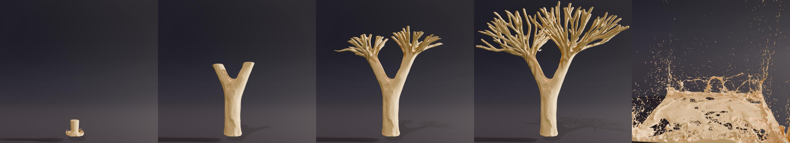

# Implicit velocity projection method for incompressible SPH fluids



Demo code for **Implicit velocity projection method for incompressible SPH fluids**, Kee et al., SIGGRAPH Asia 2026.

IP enforces the incompressibility of SPH fluids in velocity space. In each outer iteration it solves one implicit linear system for a velocity correction, using a matrix-free conjugate gradient (CG) solver on the GPU. This repository contains IP in a GPU SPH simulator built on [NVIDIA Warp](https://github.com/NVIDIA/warp), with an interactive viewer. Standard pressure solvers are included for side-by-side comparison.

## Setup

Requires an NVIDIA GPU with CUDA and Python 3.11.

```
pip install -r requirements.txt
unzip data/models.zip -d data/      # scene geometry -> data/models/
```

## Run

```
python -m scripts.main --scene_file data/scenes/dambreak_dragon.json
```

Run it as a module from the repo root. Without `--scene_file` it opens `pillar100K`, which needs about 28 GB of RAM to load.

Controls: SPACE start/pause, R reset, mouse rotate, WASD move, E/Q up/down, ESC quit.

The overlay panel shows the solver statistics and has two pages:
- **solver settings**: switch the pressure solver and edit its options, viscosity, surface tension and elasticity.
- **visualization**: colour field, hiding bodies, mesh view of static rigid bodies.

## Scenes

All scenes start with IP; any other solver can be selected in the panel while a scene is running.

| Scene | Contents |
| --- | --- |
| `dambreak_dragon` | Dam break around a static dragon |
| `small_pillar` | Thin column of about 8K particles collapsing in a box; quickest to load |
| `pillar100K` | 100K-particle column in a tall container |
| `stack` | 50 fluid dragons dropped in waves; a box appears at t = 14 s and plunges into the pool at t = 16.5 s |

## Baselines

| `pressureMethod` | Solver | Reference |
| --- | --- | --- |
| 0 | PRJ: IISPH | Ihmsen et al., IEEE TVCG 2014 |
| 0 + DF | PRJ with a divergence-free solve: DFSPH ("Divergence-Free Solve" in the panel) | Bender & Koschier, SCA 2015 |
| 5 | PBF: Position Based Fluids | Macklin & Müller, ACM TOG (SIGGRAPH) 2013 |
| 3 | SISPH: semi-implicit SPH | He et al., Eurographics 2025 |

Every solver, IP included, iterates until the average density error is below `densityErrorTol` or `maxOuterIters` is reached; the position-based solvers (PBF, SISPH) can stop on the largest particle displacement.

Other models:
- **Boundaries**: Bender, Westhofen and Jeske, *Consistent SPH Rigid-Fluid Coupling*, VMV 2023.
- **Viscosity / surface tension** (`viscosityMethod` / `surfaceTensionMethod`): 1 = implicit solvers of Weiler et al. (Eurographics 2018) and Jeske et al. (ACM TOG 2023); 0 = simple explicit versions.
- **Elasticity**: co-rotated or Stable Neo-Hookean SPH elasticity after Kee et al. (Eurographics 2023), for `SolidBodies` and spawned bodies with `"material": "solid"`.

## Code layout

```
scripts/
├── main.py              # viewer entry point
├── framework.py         # one simulation time step
├── io/                  # scene loading
├── sim/                 # particle data, neighbour search, kernels, spawns, animation
│   └── forces/
│       ├── pressure/    # ip.py (IP), prj.py, pbf.py, sisph.py, pressure_base.py
│       ├── elasticity/
│       └── non_pressure/  # viscosity, surface tension
└── visualization/       # OpenGL renderer and ImGui panel
data/scenes/             # scene JSON files
```

## License

The code is released under the MIT License (`LICENSE`). The SISPH solver is ported from [PeriDyno](https://github.com/peridyno/peridyno) (Apache-2.0). The dragon model comes from the [Stanford 3D Scanning Repository](https://graphics.stanford.edu/data/3Dscanrep/).
